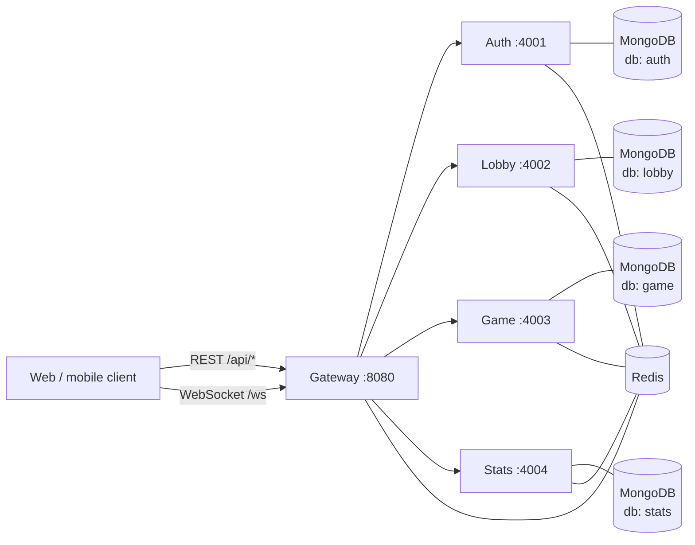
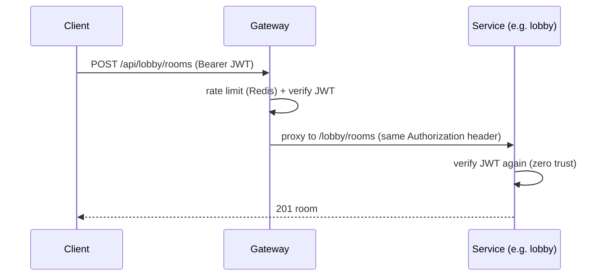
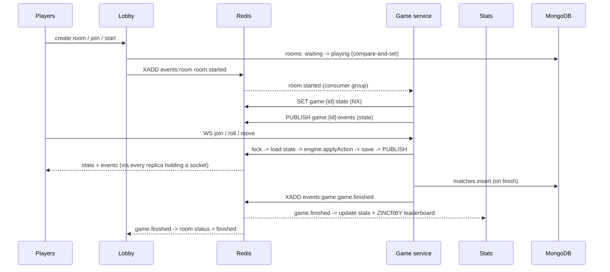

# Architecture

## 1. Goals

| Goal | How it is met |
|---|---|
| Add new games cheaply | Game rules live in pure **engines** behind one contract; services are game-agnostic |
| Scale realtime play horizontally | Game state in Redis, per-room lock, Redis pub/sub fan-out: any replica can serve any room |
| Server-authoritative (anti-cheat) | Clients send *intents* (`roll`, `move`); dice and legality are decided on the server only |
| Loosely coupled services | Database-per-service; cross-service communication via events (Redis Streams) |
| Operable | Health endpoints, structured logs with request ids, graceful shutdown, 12-factor config |

## 2. Service map

| Service | Owns | Responsibilities |
|---|---|---|
| **gateway** | nothing | TLS termination point, JWT pre-check, per-IP rate limits, routing, WebSocket proxying |
| **auth** | `auth.users`, refresh tokens | Register, login, guest accounts, JWT issue, rotating refresh tokens |
| **lobby** | `lobby.rooms`, matchmaking queues | Create/join/leave/start rooms, public room list, quick-match |
| **game** | `game.matches`, live game state | WebSocket sessions, applies actions through the engine, persists finished matches |
| **stats** | `stats.player_stats`, leaderboard | Consumes results, maintains per-player stats and ranked leaderboard |

Shared code (not a service): `@ipm/common` (infrastructure helpers) and `@ipm/game-engines` (pure rules).

## 3. Communication styles

| Style | Used for | Why |
|---|---|---|
| **Sync HTTP** client -> gateway -> service | Queries and commands that need an immediate answer | Simple, cacheable, easy to debug |
| **WebSocket** client <-> game service | In-game actions and state pushes | Low latency, server push |
| **Redis Pub/Sub** `game:{roomId}:events` | Fan-out of game state to every game replica | Ephemeral, fire-and-forget; a missed message is healed by the next state snapshot |
| **Redis Streams** `events:room`, `events:game` | Durable cross-service events | Consumer groups, acknowledgements, replay after crashes (at-least-once) |

There are **no service-to-service HTTP calls**. Lobby never calls Game; it publishes `room.started` and Game reacts.
That means any service can be down or redeployed without breaking the others - events wait in the stream.

### Event catalogue

| Stream | Type | Producer | Consumers | Payload |
|---|---|---|---|---|
| `events:room` | `room.started` | lobby | game | `{roomId, game, players:[{userId,username}]}` |
| `events:game` | `game.finished` | game | stats, lobby | `{matchId, roomId, game, players, ranking:[userId...]}` |

Delivery is **at-least-once**, so every consumer is idempotent:
* game: `SET NX` on the state key - a redelivered `room.started` cannot reset a running game
* stats: inserts `matchId` into `processed_matches` (unique `_id`) before applying results
* lobby: setting status `finished` is naturally idempotent

## 4. Flows

### 4.1 Authenticated request

### 4.2 From lobby to finished match

### 4.3 One game action (why it is safe at scale)

1. Client sends `{type:"roll", roomId}` to *any* game replica.
2. Replica takes a Redis lock `game:{roomId}:lock` (SET NX PX) - only one action per room at a time, cluster-wide.
3. Loads JSON state from Redis, runs the pure engine `applyAction(state, userId, action, serverRng)`.
4. Engine validates turn/phase/legality and returns `{state, events}`; invalid input becomes a `422` error to that player only.
5. New state saved, then published on `game:{roomId}:events`.
6. Every replica subscribed to `game:*:events` forwards the message to the sockets it holds for that room.

## 5. Key design decisions

| Decision | Alternative | Rationale |
|---|---|---|
| Pure engine package | Rules inside the game service | Deterministic, unit-testable without I/O; reusable by a bot runner or client-side prediction later |
| Live state in Redis, history in Mongo | Everything in Mongo | A game does many tiny reads/writes with TTL; Redis is fast and expires abandoned games. Mongo keeps the permanent record |
| Redis Streams for events | Kafka / RabbitMQ | Redis is already required; Streams give consumer groups and replay. Swap for Kafka behind `eventBus` when volume demands it |
| Database-per-service (shared server, separate DBs) | One shared DB | Enforces ownership: services cannot join across each other's data. Each DB can later move to its own cluster |
| JWT access (15 min) + opaque rotating refresh token | Sessions | Stateless verification at gateway/services; refresh tokens are revocable and single-use (stored hashed in Redis) |
| Gateway checks JWT *and* services re-check | Trust gateway only | A mis-routed or internal call still cannot act without a valid token |
| Server rolls dice | Client sends dice | Prevents cheating; `crypto.randomInt` |
| Lock + full-state write | Optimistic concurrency | Turn-based games have low contention per room; the lock is simple and obviously correct |

## 6. Code conventions

* ESM modules, Node >= 22, no build step.
* Every service: `src/index.js` (wiring) -> `routes.js` (HTTP + validation with zod) -> `service.js` (business logic, owns its collections).
* Errors are `AppError`s with a stable `code`; the shared handler renders `{error:{code,message,details}}`.
* All input is validated at the edge (zod for HTTP, shape checks for WS).
