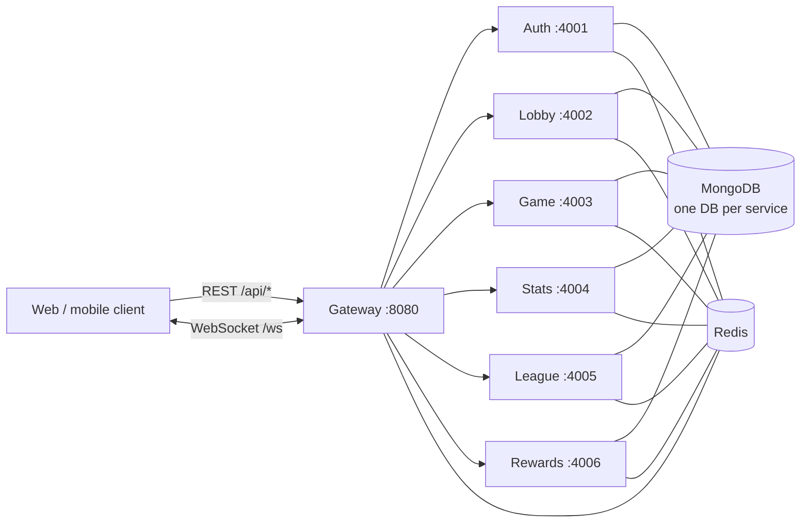
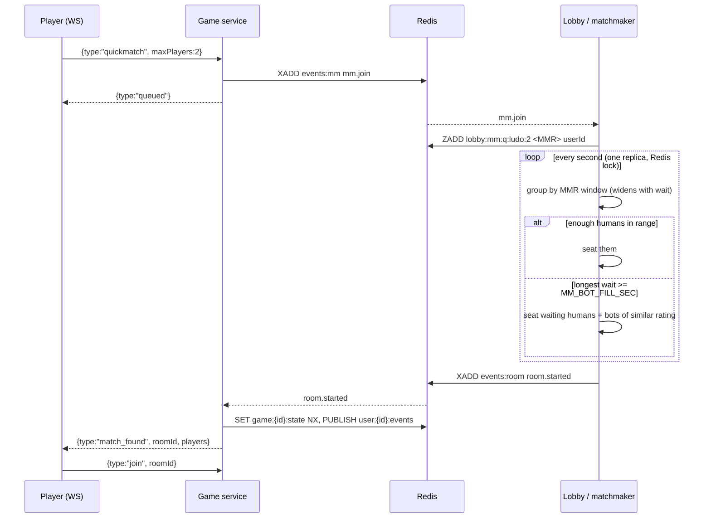
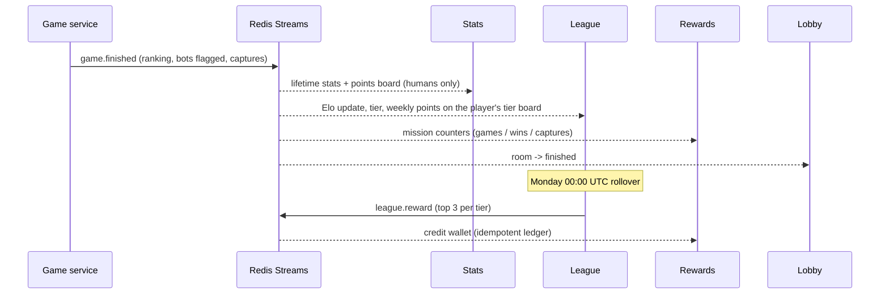

# Architecture

## 1. Goals

| Goal | How it is met |
|---|---|
| Add new games cheaply | Game rules live in pure **engines** behind one contract; services are game-agnostic |
| Scale realtime play horizontally | Game state in Redis, per-room lock, Redis pub/sub fan-out: any replica can serve any room |
| Server-authoritative (anti-cheat) | Clients send *intents* (`roll`, `move`); dice and legality are decided on the server only |
| Loosely coupled services | Database-per-service; cross-service communication via events (Redis Streams) |
| Never leave a player hanging | Turn timers auto-play absent players; bots fill empty seats; retried finalisation |
| Operable | Health endpoints, structured logs with request ids, graceful shutdown, 12-factor config |

## 2. Service map

| Service | Owns | Responsibilities |
|---|---|---|
| **gateway** | nothing | JWT pre-check, per-IP rate limits, routing, WebSocket proxying |
| **auth** | `auth.users`, refresh tokens | Register, login, guests, JWT, rotating refresh tokens |
| **lobby** | `lobby.rooms`, matchmaking queues | Room create/join/leave/start (+ fill with bots), **matchmaker** (MMR windows, bot fill) |
| **game** | `game.matches`, live game state | WebSocket sessions (matchmaking requests + play), engine calls, **turn timers**, **bot driver**, match persistence |
| **stats** | `stats.player_stats` | Lifetime played/wins/points + points leaderboard (humans only) |
| **league** | `league.ratings`, `league.rewards`, season boards | Elo MMR, tiers, weekly seasons per tier, season-end rewards |
| **rewards** | `rewards.wallets/ledger/daily_login/mission_progress` | Coin wallet, daily login streak, daily missions, pays league rewards |

Shared code (not services): `@gamearch/common` (infrastructure), `@gamearch/game-engines` (pure rules), `@gamearch/rating` (pure Elo/tier/season rules).

## 3. Communication styles

| Style | Used for | Why |
|---|---|---|
| **Sync HTTP** client -> gateway -> service | Queries and commands needing an immediate answer (rooms, wallet, leagues) | Simple, debuggable |
| **WebSocket** client <-> game service | Matchmaking requests/results and in-game actions/state | Low latency, server push |
| **Redis Pub/Sub** `game:{roomId}:events`, `user:{userId}:events` | Fan-out to every game replica (table updates, personal notifications such as `match_found`) | Ephemeral; a missed message is healed by the next state snapshot |
| **Redis Streams** `events:mm`, `events:room`, `events:game`, `events:league` | Durable cross-service events | Consumer groups, acks, replay after crashes (at-least-once) |

There are **no service-to-service HTTP calls**. Services react to events, so any one can be down or redeployed without breaking the others.

### Event catalogue

| Stream | Type | Producer | Consumers | Payload |
|---|---|---|---|---|
| `events:mm` | `mm.join` | game (from a WS `quickmatch`) | lobby | `{userId, username, game, maxPlayers}` |
| `events:mm` | `mm.cancel` | game (WS cancel / disconnect) | lobby | `{userId}` |
| `events:mm` | `mm.timeout` | lobby (only when bots are off) | game | `{userId}` |
| `events:room` | `room.started` | lobby (room start or match made) | game | `{roomId, game, players:[{userId, username, isBot?, rating?}]}` |
| `events:game` | `game.finished` | game | stats, league, rewards, lobby | `{matchId, roomId, game, players:[{userId, username, isBot, rating}], ranking:[userId...], stats:{userId:{captures}}}` |
| `events:league` | `league.reward` | league (season close) | rewards | `{userId, game, season, tier, rank, coins, reason}` |
| `events:league` | `league.season_ended` | league | (analytics / notifications later) | `{game, season}` |

Delivery is **at-least-once**, so every consumer is idempotent:
* game: `SET NX` on the state key - a redelivered `room.started` cannot reset a running game
* stats / league / rewards: a `processed_matches` row with `_id = matchId` is inserted first (unique) and removed again if processing fails so the retry can run
* rewards wallet: every credit has a ledger row whose `_id` is an idempotency key
* lobby: marking a room `finished` is naturally idempotent

## 4. Flows

### 4.1 Authenticated request

### 4.2 Quick-match (WebSocket) with bot fallback

### 4.3 From game to rewards

### 4.4 One game action (why it is safe at scale)

1. Client sends `{type:"roll", roomId}` to *any* game replica.
2. Replica takes a Redis lock `game:{roomId}:lock` (SET NX PX) - only one action per room at a time, cluster-wide.
3. Loads JSON state from Redis, runs the pure engine `applyAction(state, userId, action, serverRng)`.
4. Engine validates turn/phase/legality; invalid input becomes an error to that player only.
5. The state gets a new `turnDeadline`, is saved, then published on `game:{roomId}:events`.
6. Every replica subscribed to `game:*:events` forwards the message to its sockets for that room.

### 4.5 Timers and bots (no per-room timers in memory)

Every committed state registers `roomId -> deadline` in the Redis sorted set `game:deadlines`
(`turnTimeoutMs` for humans, `botDelayMs` for bots). Every game replica runs a 250 ms ticker that takes the due rooms,
locks each one, **re-checks the deadline** (someone may have acted a moment ago) and then either

* plays the bot's turn with `engine.suggestAction(state)`, or
* applies `engine.onTimeout(state)` to a human: auto-roll/auto-move, and after 3 consecutive misses a forfeit.

Because nothing lives in process memory, a replica crash loses no timers.

## 5. Key design decisions

| Decision | Alternative | Rationale |
|---|---|---|
| Pure engine and rating packages | Rules inside services | Deterministic, unit-testable without I/O; reusable by a bot runner or client-side prediction |
| Live state in Redis, history in Mongo | Everything in Mongo | A game does many tiny reads/writes with TTL; Redis expires abandoned games. Mongo keeps the permanent record |
| Matchmaking requests on the game WebSocket, queue logic in lobby | Separate matchmaking socket | One connection per player; lobby keeps ownership of rooms/queues; they communicate by events only |
| Redis Streams for events | Kafka / RabbitMQ | Redis is already required; consumer groups and replay. Swap behind `eventBus` when volume demands it |
| Database-per-service | One shared DB | Enforces ownership; each DB can later move to its own cluster |
| `league:mmr:{game}` ZSET written by league, read by lobby | Lobby calls league over HTTP | Matchmaking must be fast and survive a league outage. It is a deliberately published read-model (league rebuilds it from Mongo if Redis was wiped) |
| Ledger with idempotency keys | Plain `$inc` on balance | Retries and redeliveries cannot double-pay; every coin is auditable |
| Bot games count half for rating and weekly points | Full value | Bots keep queues short but cannot be farmed |
| JWT access + opaque rotating refresh token | Sessions | Stateless verification; refresh tokens revocable and single-use |
| Server rolls dice | Client sends dice | Prevents cheating; `crypto.randomInt` |
| Lock + full-state write | Optimistic concurrency | Turn-based games have low contention per room; simple and obviously correct |

## 6. Code conventions

* ESM modules, Node >= 22, no build step.
* Every service: `src/index.js` (wiring) -> `routes.js` (HTTP + zod validation) -> `service.js` (business logic, owns its collections). Pure rule modules (`matching.js`, `definitions.js`, `@gamearch/rating`, engines) have no I/O and are unit tested.
* Errors are `AppError`s with a stable `code`; the shared handler renders `{error:{code,message,details}}`.
* All input is validated at the edge (zod for HTTP, shape checks for WS).
